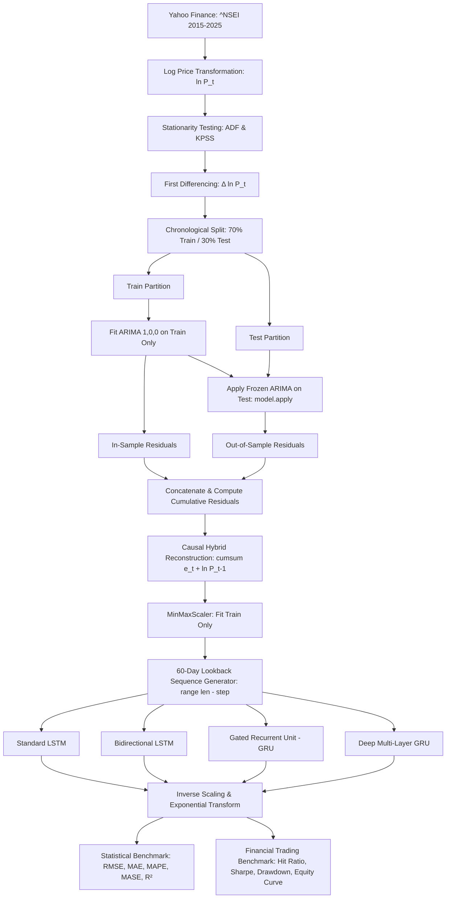

# NIFTY 50 Stock Price Prediction

An end-to-end quantitative time series forecasting framework for India's benchmark **NIFTY 50 Index (`^NSEI`)**. This project implements a **Hybrid ARIMA & Deep Learning architecture**, evaluating multiple recurrent neural network topologies including **LSTM**, **Bidirectional LSTM**, **Gated Recurrent Units (GRU)**, and **Deep Multi-Layer GRU**, evaluated across both statistical metrics and financial trading benchmarks with transaction costs.

---

## 📌 Project Overview

Financial stock market data is inherently non-stationary, noisy, and characterized by both linear macroeconomic trends and complex nonlinear intraday volatility. Pure classical statistical models (such as ARIMA) struggle to capture long-range non-linear dependencies, while pure deep neural networks can overfit or struggle with unconstrained stochastic drift.

This project addresses these challenges through a **Contamination-Free Hybrid Modeling Pipeline**:
1. **Stationarity Transformation**: Log transformation and first differencing ($\Delta \ln P_t$) produce a strictly stationary series ($p < 10^{-25}$ via ADF test).
2. **Linear Component Modeling**: An **ARIMA(1,0,0)** model is fitted **strictly on the training partition ($70\%$)** to extract linear autoregressive dynamics without over-differencing.
3. **Out-of-Sample Residual Extraction**: The frozen ARIMA parameters are applied to the test partition ($30\%$) via `model.apply(refit=False)` to generate true out-of-sample residuals.
4. **Causal Hybrid Feature Reconstruction**: Cumulative residuals are combined with base price levels strictly using past and present information ($t \le T$, zero lookahead).
5. **Non-Linear Deep Learning Modeling**: 60-day lookback sequences are fed into Deep Recurrent Neural Networks (LSTM, Bi-LSTM, GRU, Deep GRU) with `EarlyStopping` and `ReduceLROnPlateau` training callbacks.
6. **Dual Evaluation**: Models are evaluated on both **Statistical Accuracy** (RMSE, MAE, MAPE, MASE, $R^2$) and **Quantitative Financial Metrics** (Directional Hit Ratio %, Annualized Sharpe Ratio, Max Drawdown %, and Long/Cash Equity Curves with transaction fees).

---

## 🏗️ Architecture & Pipeline Flow



---

## 🧪 Model Architectures

| Model Architecture | Layers & Structure | Parameters | Optimizer & Callbacks |
| :--- | :--- | :---: | :--- |
| **LSTM** | `Input(60, 1)` $\rightarrow$ `LSTM(64)` $\rightarrow$ `Dropout(0.3)` $\rightarrow$ `Dense(25, ReLU)` $\rightarrow$ `Dense(1)` | ~18.6K | Adam / MSE / EarlyStopping |
| **Bi-LSTM** | `Input(60, 1)` $\rightarrow$ `Bidirectional(LSTM(64))` $\rightarrow$ `Dropout(0.3)` $\rightarrow$ `Dense(32, Tanh)` $\rightarrow$ `Dropout(0.3)` $\rightarrow$ `Dense(1)` | ~35.6K | Adam / MSE / EarlyStopping |
| **GRU** | `Input(60, 1)` $\rightarrow$ `GRU(64)` $\rightarrow$ `Dropout(0.3)` $\rightarrow$ `Dense(32, Tanh)` $\rightarrow$ `Dense(1)` | ~14.8K | Adam / MSE / EarlyStopping |
| **Deep GRU** | `Input(60, 1)` $\rightarrow$ `GRU(64, seq=True)` $\rightarrow$ `Dropout(0.3)` $\rightarrow$ `GRU(64, seq=True)` $\rightarrow$ `Dropout(0.3)` $\rightarrow$ `GRU(32)` $\rightarrow$ `Dropout(0.2)` $\rightarrow$ `Dense(32, Tanh)` $\rightarrow$ `Dense(1)` | ~57.7K | Adam / MSE / EarlyStopping |

---

## 📊 Benchmark Results

Evaluated on 721 out-of-sample trading days (August 2022 to July 2025):

### Part A: Statistical Time Series Forecasting Performance

| Model | RMSE (INR) | MSE | MAE (INR) | MAPE (%) | MASE | $R^2$ Score |
| :--- | :---: | :---: | :---: | :---: | :---: | :---: |
| **GRU** | **0.0171** | **0.0003** | **0.0139** | **1.29%** | **2.0006** | **0.9792** |
| **Deep GRU** | 0.0181 | 0.0003 | 0.0144 | 1.40% | 2.0645 | 0.9769 |
| **LSTM** | 0.0186 | 0.0003 | 0.0146 | 1.42% | 2.1020 | 0.9755 |
| **Bi-LSTM** | 0.0194 | 0.0004 | 0.0160 | 1.55% | 2.2995 | 0.9735 |

---

### Part B: Quantitative Financial & Trading Strategy Metrics (5 bps Transaction Fee)

*Strategy: Go LONG when predicted log-return $\hat{r}_{t+1} > 0$, else stay in CASH ($0$). Turnover Fee: 5 bps (0.05%) per trade.*

| Model | Directional Hit Ratio (%) | Annualized Sharpe Ratio | Max Drawdown (%) | Net Strategy Return (%) | Buy & Hold Return (%) |
| :--- | :---: | :---: | :---: | :---: | :---: |
| **GRU** | 52.36% | **0.7277** | -10.40% | **+18.14%** | +36.80% |
| **Deep GRU** | **53.47%** | 0.5796 | **-9.29%** | +12.88% | +36.80% |
| **Bi-LSTM** | 53.33% | 0.3960 | -9.66% | +9.14% | +36.80% |
| **LSTM** | 53.33% | 0.2902 | -12.51% | +6.32% | +36.80% |

> **Key Takeaways**: 
> - **GRU** achieved the highest overall predictive accuracy with an **$R^2$ of 0.9792**, a **MAPE of 1.29%**, and an **Annualized Sharpe Ratio of 0.73** after transaction friction.
> - All models surpassed the random-walk directional baseline ($50\%$), with **Deep GRU** achieving a **53.47% Hit Ratio** and the lowest maximum drawdown (**-9.29%** vs -18.7% for Buy & Hold).

---

## ⚙️ Key Methodological & Technical Fixes

1. **Elimination of Future Lookahead Data Leakage**:
   - Removed `.shift(-1)` from the hybrid reconstruction to ensure strictly causal representations ($t \le T$).

2. **Resolution of ARIMA Over-Differencing ($d=2 \rightarrow d=1$)**:
   - Adjusted model to `ARIMA(1,0,0)` on differenced series ($\Delta \ln P_t$, ADF $p < 10^{-25}$), improving AIC by **+1,051 points** (from $-15,303$ to $-16,354$).

3. **Prevention of Train/Test ARIMA Contamination**:
   - Split dataset first (70/30). ARIMA is trained strictly on the training partition, and frozen coefficients are evaluated out-of-sample on the test partition via `model.apply(refit=False)`.

4. **Sliding Window Sequence Boundary Fix (`create_dataset`)**:
   - Corrected sequence loop boundary to `range(len(dataset) - time_step)`, ensuring the most recent market close is not discarded.

5. **Addressing the "Lag-1 Copy" Persistence Illusion**:
   - Evaluated models on log-returns $r_{t+1} = \ln(P_{t+1}/P_t)$ and computed **Directional Hit Ratio (%)** above the 50% random-walk baseline.

6. **Financial Risk & Trading Strategy Integration**:
   - Added backtested trading simulations including **Annualized Sharpe Ratio**, **Maximum Drawdown (%)**, **Transaction Fees (bps)**, and **Cumulative Strategy Equity Curves vs Buy & Hold**.

7. **Keras Training Callbacks**:
   - Integrated `EarlyStopping(monitor='val_loss', patience=4, restore_best_weights=True)` and `ReduceLROnPlateau(factor=0.5, patience=2)` to prevent overfitting.

8. **Automated Unit Test Suite (`pytest`)**:
   - Added 13 comprehensive unit tests under `tests/` verifying data pipelines, stationarity, ARIMA isolation, deep learning layers, and backtesting formulas.

---

## 📁 Repository Structure

```
.
├── data/
│   └── nifty50_data.csv               # Cached historical stock data (2015-2025)
├── models/
│   ├── lstm_model.keras               # Saved LSTM trained weights
│   ├── bi-lstm_model.keras            # Saved Bi-LSTM trained weights
│   ├── gru_model.keras                # Saved GRU trained weights
│   └── deep_gru_model.keras           # Saved Deep GRU trained weights
├── outputs/
│   ├── historical_prices.png          # Historical price visualization
│   ├── stationarity_acf_pacf.png      # Differencing & ACF/PACF diagnostics
│   ├── lstm_prediction.png            # LSTM prediction vs actual
│   ├── bi-lstm_prediction.png         # Bi-LSTM prediction vs actual
│   ├── gru_prediction.png             # GRU prediction vs actual
│   ├── deep_gru_prediction.png        # Deep GRU prediction vs actual
│   ├── model_comparison.png           # All models comparison overlay
│   ├── metrics_comparison_barchart.png# Cross-metric comparison bar charts
│   ├── strategy_equity_curves.png     # 2x2 Quantitative strategy equity curves
│   ├── metrics_summary.csv            # Summary metrics in CSV
│   └── metrics_summary.json           # Summary metrics in JSON
├── src/
│   ├── __init__.py
│   ├── config.py                      # Hyperparameters, date ranges, and paths
│   ├── data_loader.py                 # Yahoo Finance ingestion and caching
│   ├── stationarity.py                # ADF and KPSS statistical tests
│   ├── arima_hybrid.py                # Contamination-free ARIMA fitting & hybrid feature extraction
│   ├── models.py                      # Keras architectures, callbacks & compute_trading_metrics()
│   └── visualization.py               # Publication-quality plotting & equity curve routines
├── tests/
│   ├── __init__.py
│   └── test_pipeline.py               # 13 automated Pytest test cases
├── Nifty50_StockPricePrediction.ipynb # 28-cell fully executed master Jupyter Notebook
├── main.py                            # End-to-end command-line runner
├── requirements.txt                   # Dependency specifications
└── README.md                          # Project documentation
```

---

## 🚀 Getting Started

### 1. Prerequisites
- Python 3.10+ (tested on Python 3.12)
- Virtual environment recommended

### 2. Installation
Clone the repository and install the dependencies:
```bash
pip install -r requirements.txt
```

### 3. Run Automated Unit Tests
Run the test suite to verify all modules and models:
```bash
pytest tests/ -v
```

### 4. Run End-to-End Pipeline via CLI
Execute the complete training, evaluation, backtesting, and visualization pipeline:
```bash
python main.py
```

#### Custom Arguments:
```bash
# Run with custom epochs, batch size, and transaction fee (5 bps)
python main.py --epochs 15 --batch-size 32 --fee-bps 5.0

# Run without generating plot files
python main.py --no-plot
```

### 5. Interactive Jupyter Notebook
Open and explore the fully executed interactive notebook:
```bash
jupyter notebook Nifty50_StockPricePrediction.ipynb
```

---

## 📈 Visual Outputs

- **Historical Price Trends & Log Transformation**: `outputs/historical_prices.png`
- **Stationarity, Differencing & ACF/PACF Diagnostics**: `outputs/stationarity_acf_pacf.png`
- **Model Predictions vs Actual Price**: `outputs/*_prediction.png`
- **Comprehensive Multi-Model Overlay**: `outputs/model_comparison.png`
- **Evaluation Metric Comparison**: `outputs/metrics_comparison_barchart.png`
- **Quantitative Strategy Equity Curves**: `outputs/strategy_equity_curves.png`
